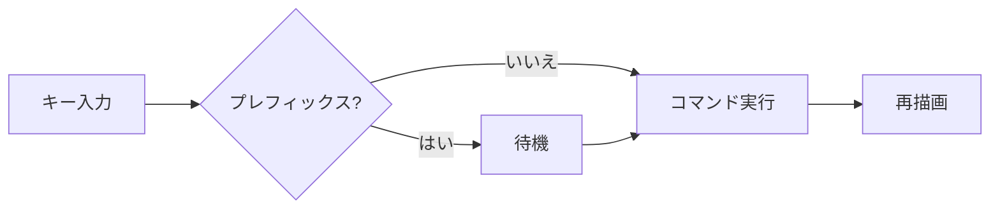
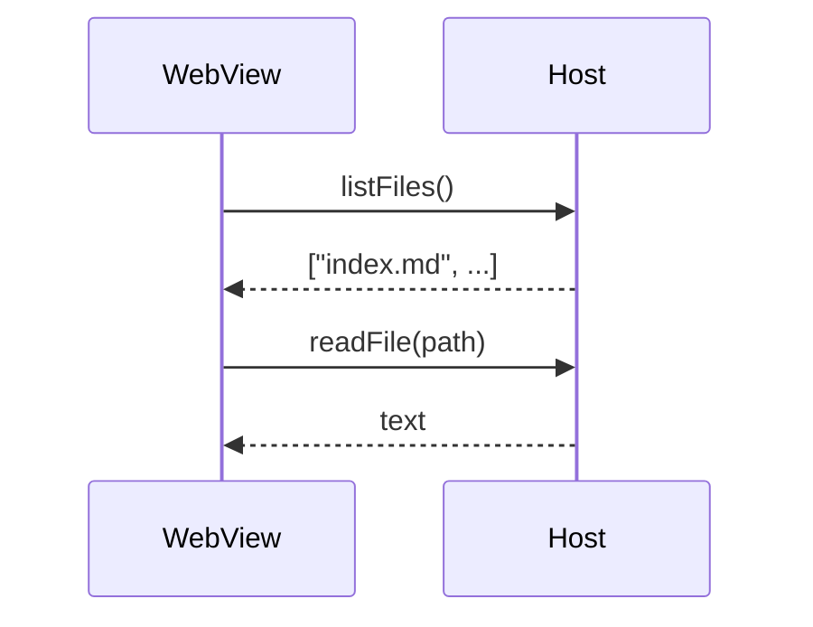
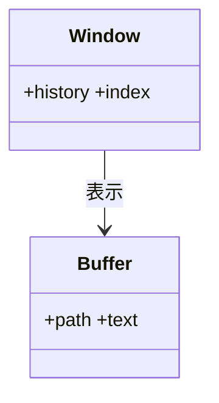
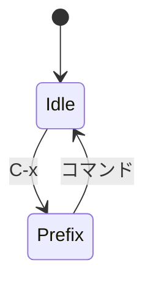
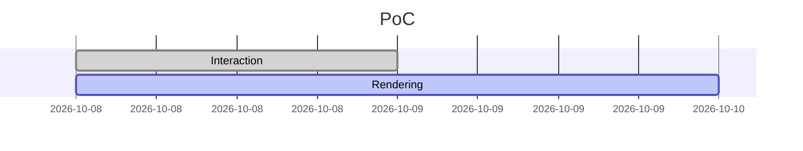
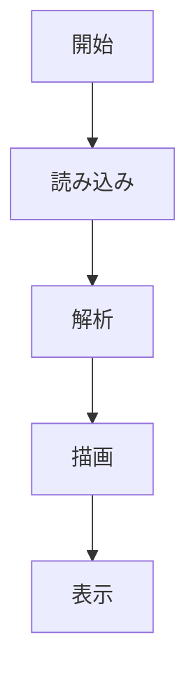

# Mermaid

## フローチャート



## シーケンス図



## クラス図



## 状態遷移図



## ガント



## エラー(構文エラー): この下の文章は表示されます

```mermaid
flowchart LR
  A --> 
  this is not valid mermaid ((
```

## 日本語ラベルと長い図



図の後ろの文章です。
